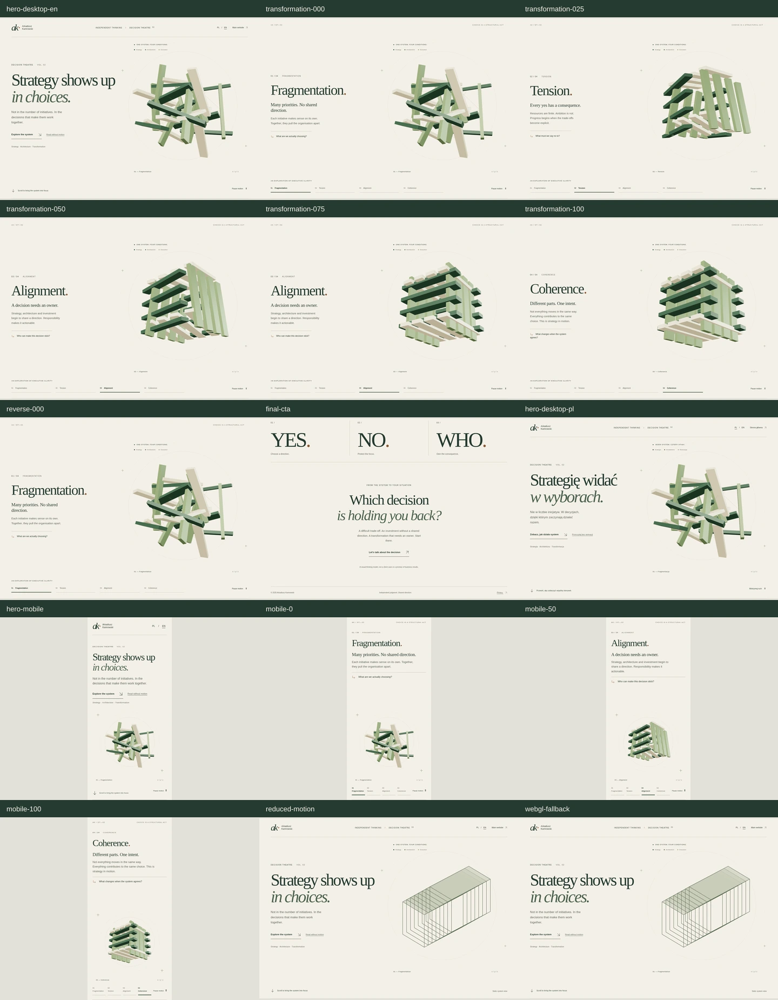

# Decision Theatre 2.0

Historical V2 implementation and evidence. Superseded by [Decision Theatre V3](DECISION_THEATRE_V3.md) after owner feedback rejected the fixed-copy presentation model.

Prototype: `/lab/decision-theatre-v2` (PL), `/en/lab/decision-theatre-v2` (EN).
Branch: `feature/decision-theatre-gsap-three`. No merge or deployment is part of this delivery.

## Creative contract

Self-authored under explicit creative delegation, using the user's complete Decision Theatre brief. Audience: CEOs, CIOs, CTOs, boards, transformation leaders and executive recruiters. This is enterprise and organisational architecture; the geometry is an abstract dependency model, not a physical building or client evidence.

Two concepts were considered: a planar decision map and a spatial modular assembly. The spatial assembly was chosen because the brief explicitly calls for real perspective, object reorganisation and camera choreography. A preliminary curved-aperture direction was discarded when the complete brief specified rectangular structural modules.

The page uses a continuous split stage: editorial argument at left, one object system at right. On phones, reading sits above the system. Existing green/cream materials and the site's serif/sans typography remain the brand anchors. There are no remote fonts, generated images, extra trackers or fabricated business metrics.

The signature is three interlocking families of eight elongated rectangular modules. Direction, architecture and execution remain recognisable through separation and assembly. They are never replaced by a second scene. Twenty-four sparse dependency lines connect their actual changing origins.

| Beat | Feeling | Visible cause | Transformation interval |
| --- | --- | --- | --- |
| Hero | Curiosity, authority | A complete editorial claim with an unresolved spatial structure | Initial camera approach |
| Fragmentation | Recognition | Related modules have inconsistent positions and orientations | 0–22% |
| Tension | Consequence | Families separate along competing axes; dependency lines expose gaps | 22–43% |
| Alignment | Relief, agency | The same modules rotate and settle onto common axes in a staggered sequence | 43–80% |
| Coherence | Confidence | The assembly tightens and the camera makes a final restrained orbit | 80–100% |
| Ending | Relevance | YES / NO / WHO connects the model to one real conversation | Native document flow |

The engineered peak is alignment. The longest object-transition interval is reserved for it. The intended tell-someone sentence: “It is the site where the same competing pieces become one executable decision.” No snap scrolling, wheel interception or artificial scene cuts. The static reading sequence is always available as a direct bypass.

Scroll Craft is used for narrative, hero depth, a single emotional peak, deliberate phone composition and frame-by-frame verification. Its runtime and asset-generation workflow are not used. Brand rules and the user's one-continuous-system brief take precedence over its general template/grammar recommendations.

References inspected:
- [GSAP ScrollTrigger](https://gsap.com/docs/v3/Plugins/ScrollTrigger/)
- [Three.js](https://github.com/mrdoob/three.js)
- [Scroll Craft](https://github.com/nateherkai/scroll-craft), including its SKILL and hero-depth reference

## Dependency decision

Pinned official releases: GSAP 3.15.0, Three.js 0.186.1, `@types/three` 0.186.0. Existing Playwright 1.62.1 is reused.

GSAP supplies deterministic sequencing and scroll lifecycle/refresh control. Three.js supplies actual lit geometry, occlusion, perspective and camera movement. The approved spatial assembly would become disproportionately fragile as ad hoc DOM transforms. No Theatre Studio/editor, Scroll Craft engine or client framework ships.

The complete graphics module loads only on the lab route and only when reduced motion is off. There is no graphics request on existing public pages. Rejection is reversible: delete the two lab entry pages, shared lab component/scripts/styles, capture/test files, then remove the three packages and the isolated lab budget. Existing public page source remains unchanged.

## Runtime and fallback contract

- GSAP drives a paused deterministic timeline from native scroll progress; CSS sticky handles the stage without pinning or scroll hijacking.
- One normalised progress value selects the DOM argument and the WebGL state. Forward and reverse rendering use the same objects and timeline.
- Rendering happens on scroll/resize/visibility restoration. There is no permanent requestAnimationFrame loop or ambient GPU work at rest.
- Pixel ratio is capped at 1.5 on desktop and 1.25 on phones. ResizeObserver updates the camera and framebuffer.
- Context loss destroys the scene and reveals the static SVG and full reading sequence. Renderer, materials, buffers, timeline, observers and handlers are disposed on navigation.
- Reduced-motion mode skips the graphics import, uses a static structural diagram and removes the long sticky section. Live preference changes reinitialise or dispose the scene.
- JavaScript unavailable, failed graphics loading and WebGL unavailable retain all important copy, diagram, reading links and contact CTA.
- Lab pages are noindex/nofollow, excluded from sitemap and absent from public navigation. The existing CSP does not need to be relaxed; scripts remain external.

## Local preview and verification

Use the existing cloud checkout; no extra worktree is required. Node >=22.12.0, npm and Python 3 are prerequisites.

```bash
cd /workspace/Simple-Website
npm ci --no-audit --no-fund
ASTRO_TELEMETRY_DISABLED=1 SITE_BASE_URL=https://arkadiuszkamrowski.com REQUIRE_PRODUCTION_SITE=1 npm run build
ASTRO_TELEMETRY_DISABLED=1 npm run preview
```

Astro serves port 4173. Navigate to `/lab/decision-theatre-v2` or `/en/lab/decision-theatre-v2` on that local preview. This Astro version starts a background daemon; start it explicitly before Playwright so its exit is not mistaken for a failed webServer startup. Status/stop: `ASTRO_TELEMETRY_DISABLED=1 npx --no-install astro preview status` / `astro preview stop`.

```bash
ASTRO_TELEMETRY_DISABLED=1 PLAYWRIGHT_CHROMIUM_EXECUTABLE=/usr/bin/chromium npm run test:decision-theatre
XDG_CACHE_HOME=/workspace/.cache npm run capture:decision-theatre
```

On other machines use Playwright's installed browser by omitting `PLAYWRIGHT_CHROMIUM_EXECUTABLE` for tests; set it to the local Chromium path for capture. Capture output is in ignored `artifacts/decision-theatre/`, including full-resolution frames, a contact sheet and a JSON result record. Committed review images live beside this document in `decision-theatre-v2-evidence/`.

## Performance policy

The existing public-route budgets remain unchanged, including the 8 KiB raw JS cap and 1,800 KiB public artifact cap. `artifact-scope.mjs` traverses local script dependencies from every built HTML route, including dynamic imports. Only assets reachable exclusively from the two noindex lab pages receive a separate prototype budget. Shared dependencies stay charged to the public site. Orphan files also stay charged to the public site; a filename prefix cannot exempt them. Source maps are forbidden in both scopes.

Lab ceilings: 240 KiB gzip JavaScript and 1,000 KiB total lab-exclusive artifact. This is an explicit prototype allowance, not approval to introduce the same payload on the homepage. The build's >500 kB chunk warning is retained. Device GPU profiling and a further payload review are required before any public-site promotion.

## Verification and Creative Director audit

Visual review was performed on real Chromium screenshots, including the full-size opening, complete 0/25/50/75/100% contact sheet, mobile opening and final coherent frame. This is a Creative Director self-review, not independent owner acceptance.



[Desktop hero](decision-theatre-v2-evidence/hero-desktop-en.webp) · [Polish hero](decision-theatre-v2-evidence/hero-desktop-pl.webp) · [Mobile hero](decision-theatre-v2-evidence/hero-mobile.webp) · [Coherence](decision-theatre-v2-evidence/transformation-100.webp) · [Final CTA](decision-theatre-v2-evidence/final-cta.webp) · [Reduced motion](decision-theatre-v2-evidence/reduced-motion.webp).

| Area | Visual audit |
| --- | --- |
| Executive hero | Oversized serif claim, restrained green/cream palette, precise typographic hierarchy and a usable CTA. The diagram is subordinate to the argument rather than placed behind readable copy. |
| Signature system | The same green, sage and ivory modules retain their family identity. Dependency lines expose relationships before the three axes settle into a legible assembly. No unrelated scene or crossfade substitutes for transformation. |
| Peak and resolution | Alignment receives the longest transition and a coordinated camera move; coherence preserves negative space between the modules. The final short orbit resolves the view rather than introducing another visual peak. |
| Desktop composition | Object and argument occupy separate fields. Header, frame annotations, timeline controls and CTA remain distinct. No critical text/object collision was observed in the inspected frames. |
| Phone composition | Typography and actions sit above the system. The complete hero fits the 390 × 844 opening; 320 px reflow was exercised. The subject remains fully framed instead of cropping the desktop scene. |
| Accessibility and fallbacks | Essential content is native HTML. Static ordered reading remains available at all times. Reduced-motion/WebGL fallback frames retain an intentional structural illustration and primary contact path. |
| Continuity | Forward/reverse quarter positions produce identical canvas PNGs in both Chromium projects. Native mouse-wheel movement advances and reverses the progress value. At rest, render count remains unchanged. |

Refinements made during three visual/QA passes: replaced unsupported arrow glyphs with SVG icons; corrected the opening viewport height; eliminated the 320 px choice-strip overflow; canonicalised the initial object transforms to the same precision as GSAP interpolation so reverse-to-zero is pixel-identical.

### Prioritised remaining risks

- **Critical/high:** none observed in the verified Chromium scope. This does not establish equivalence on untested browsers or devices.
- **P2 – native GPU performance: NOT VERIFIED.** Functional WebGL is verified through SwiftShader only. Real-device frame timing, thermal behaviour and memory pressure still need profiling before public use.
- **P2 – browser/device coverage:** Firefox, WebKit/Safari, real iOS touch/address-bar behaviour and screen-reader use were not exercised in this cloud run. Existing CI retains its cross-browser gates.
- **P2 – graphics payload:** 173.3 KiB gzipped lab JavaScript, 674.1 KiB total lab-exclusive artifact. The >500 kB raw chunk advisory remains visible; further reduction is appropriate before homepage promotion. Public JS remains 7.0 KiB raw and public artifact 1,702.2 KiB.
- **P3 – visual interpretation:** this is a deliberately abstract organisational model. The strategy/architecture/execution labels and executive copy carry its meaning; it is not a literal representation of a building or a proven transformation outcome.

No staging or production deployment was performed. The prototype is isolated for review, not a site-wide release.


### Final executed results (2026-10-15)

- `npm run test:static`: PASS (Astro check/build, 22 required translated routes, editorial asset/language checks, Worker/contact/measurement/privacy checks, local contact adapter and production predeploy contract tests).
- `npm run test:performance`: PASS, including the artifact-scope regression test and all original public-route limits.
- Full Playwright desktop/mobile Chromium run: **265 passed, 1 intentionally skipped**, 266 selected tests, 3.3 minutes. The skip is the desktop project's mobile-navigation-only scenario.
- The 18 Decision Theatre project tests are included in that total and also passed separately. They cover both locales, axe accessibility, all five quarter positions, exact forward/reverse canvas PNG comparison, pause/resume, keyboard navigation, 320 px reflow, reduced-motion toggling, no-JS operation, WebGL denial/context loss and public-bundle/sitemap isolation.
- Final capture run: 15 screenshots, zero collected browser errors, idle render count stable. Native mouse wheel advanced progress from 0 to 0.29968 and reversed to 0.10148 without intercepting the wheel.
- `git diff --check` and capture-script syntax validation: PASS.

Current-instance verification does not establish a deployed preview, CI completion, new-cloud-task restoration, native GPU frame rate or public release readiness.
