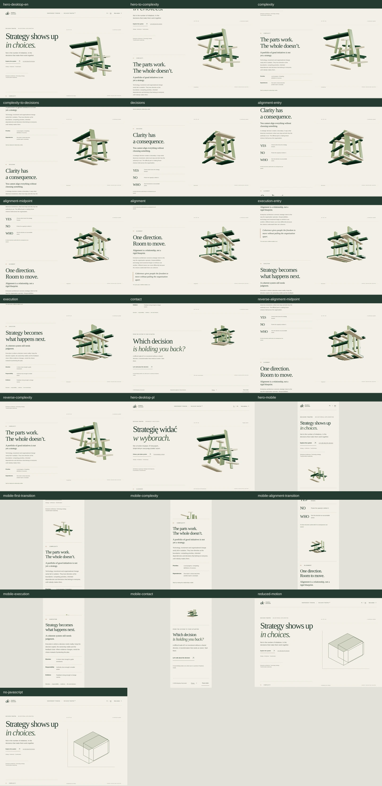

# Decision Theatre V3: continuous editorial scroll

Current prototype: `/lab/decision-theatre-v2` (PL) and `/en/lab/decision-theatre-v2` (EN). The existing URLs are preserved. Branch: `feature/decision-theatre-gsap-three`; draft PR #80. No merge or deployment.

## How V3 changes the experience

Owner feedback rejected V2's presentation-like architecture. V3 replaces its layout and scroll model; the change is not an easing revision.

| V2 | V3 |
| --- | --- |
| A 540svh spacer served one sticky stage. | Six semantic sections determine document height through their actual text and composition. |
| Absolutely positioned editorial states were swapped with `hidden`. | All headings, paragraphs and supporting content remain in normal flow, available throughout the visit. No editorial hidden-state switching. |
| Text stayed in place while the world progressed. | Text enters and leaves through native vertical scrolling. Multiple sections can occupy the viewport together. |
| One synthetic normalised scroll interval selected states. | Measured section anchors drive one continuous scene timeline; changes in text length remeasure its timing. |
| The readable explanation came after the animation. | Complexity, Decisions, Alignment and Execution carry the explanation in the main narrative. |
| Repeated structural modules formed a dense cubic cage. | Eighteen related modules have varied lengths, widths, bevels and depths with a more open, asymmetric resolution. Phones display twelve. |

The website now owns the reading sequence. The world accompanies it without choosing which text the visitor can access.

## Art direction and narrative

Self-authored under the owner's explicit V3 mandate. Two layouts were considered: alternating full-width spatial scenes and a continuous side composition. The continuous side composition was chosen because it retains object identity and gives the editorial argument a stable reading lane. It also lets a heading leave while the next argument enters without a scene cut.

- **Hero:** the existing executive thesis, brand identity and contact path, with a calm unresolved structure.
- **Complexity:** the relationship between locally sensible initiatives and organisational dependencies. The world opens and reveals gaps.
- **Decisions:** YES / NO / WHO connects trade-offs to authority and accountability. Separation exposes the consequences of incompatible choices.
- **Alignment:** the main spatial transformation. The same modules reorient around shared axes, with deliberately unequal proportions and negative space.
- **Execution:** a more resolved structure accompanies direction, responsibility and evidence. Feedback replaces the notion of a permanently perfect plan.
- **Contact:** the scene recedes and the primary conversation CTA completes the argument.

The geometry is an abstract organisational relationship model. It does not depict a physical building or a client result. Existing green/cream materials, local serif/sans typography, no invented achievements and PL/EN parity remain intact.

## Scroll and lifecycle architecture

Only the decorative spatial field uses sticky positioning. Every `.dt-copy` is static or relative inside its section; no headline or paragraph is pinned, faded out by timeline progress or removed from the accessibility tree. Editorial index labels have a small entrance translation; headings and prose remain fully opaque.

Each section registers a ScrollTrigger using `top bottom` / `bottom top` relationships. A shared synchroniser calculates its position between anchors measured from the actual copy geometry. One smoothed playhead drives all object, camera and lighting properties. This avoids competing timelines and hardcoded percentages of an artificial scroll spacer. Native anchors and normal wheel/touch scrolling remain available.

On phones the scene follows measured open margins between copy blocks. These margins are part of the reading composition, not viewport-length scenes. Opaque reading surfaces protect text; when copy fills the screen, the scene stays behind it. The spatial layer does not reserve layout height or intercept input. A pause freezes the visual world while the document remains scrollable.

Rendering occurs on scene changes and resize, with bounded pixel ratio (1.5 desktop / 1.25 phone). There is no permanent rendering loop at rest. A ResizeObserver remeasures content and framebuffer geometry. Context loss, navigation and reduced-motion changes dispose renderers, buffers, materials, observers, triggers and animation drivers.

Reduced motion skips the Three.js/GSAP graphics import, retains a static SVG and uses exactly the same editorial document. WebGL denial, failed imports and no JavaScript preserve the complete narrative and CTA. Noindex, sitemap exclusion, external-script CSP and isolation from public pages are preserved.

## Preview and reproducible verification

```bash
cd /workspace/Simple-Website
ASTRO_TELEMETRY_DISABLED=1 SITE_BASE_URL=https://arkadiuszkamrowski.com REQUIRE_PRODUCTION_SITE=1 npm run build
ASTRO_TELEMETRY_DISABLED=1 npm run preview
```

Visit the existing lab paths on the local preview at port 4173. In this agent environment Astro starts its preview daemon in the background, so start it explicitly before Playwright. Status/stop: `ASTRO_TELEMETRY_DISABLED=1 npx --no-install astro preview status` / `astro preview stop`.

```bash
ASTRO_TELEMETRY_DISABLED=1 PLAYWRIGHT_CHROMIUM_EXECUTABLE=/usr/bin/chromium npm run test:decision-theatre
XDG_CACHE_HOME=/workspace/.cache npm run capture:decision-theatre
```

Raw screenshots and the JSON capture record go to ignored `artifacts/decision-theatre-v3/`. Committed review copies live in `decision-theatre-v3-evidence/`. Historical V2 evidence is retained separately for comparison.

## Critical Creative Director review

The final review is based on 22 real Chromium captures, including intermediate desktop/phone positions, multiple visible sections, direction reversal, reduced motion and the final CTA.



[Desktop opening](decision-theatre-v3-evidence/hero-desktop-en.webp) · [First transition](decision-theatre-v3-evidence/hero-to-complexity.webp) · [Adjacent arguments](decision-theatre-v3-evidence/complexity-to-decisions.webp) · [Alignment midpoint](decision-theatre-v3-evidence/alignment-midpoint.webp) · [Mobile opening](decision-theatre-v3-evidence/hero-mobile.webp) · [Mobile transition](decision-theatre-v3-evidence/mobile-alignment-transition.webp) · [Contact](decision-theatre-v3-evidence/contact.webp).

This is a Creative Director self-review, not independent owner acceptance. The review included the full contact sheet and full-size desktop mid-scroll, phone hero and phone inter-section transition images.

| Criterion | Critical assessment |
| --- | --- |
| Experience architecture | The defining V2 defect is removed. Real prose moves through the viewport. Supporting definitions and the YES / NO / WHO choices are now the argument itself, not a transcript appended to an animation. |
| Editorial quality | Large serif claims, compact indices and narrower prose establish a publication-like hierarchy. Headings can be partly outside the viewport as a normal consequence of scrolling; their content is never replaced or faded by the scene timeline. |
| Continuity | A single set of modules maintains its identity through opening, separation, reorganisation and resolution. The side field provides continuity while different arguments coexist. |
| Spatial sophistication | Bevels, unequal lengths, broader planes, soft directional illumination and an open asymmetric assembly improve depth and reduce the repetitive cage effect. The vocabulary remains deliberately geometric and restrained. |
| Mobile | The reading lane owns the full width. The subject uses actual inter-section margins and fewer modules. When a paragraph fills the screen, reading takes precedence over displaying the whole object. |
| Contact | The object becomes smaller and the CTA remains an ordinary link in the document. The page ends with a practical conversation rather than another scene transition. |

Three visual/QA passes addressed the main issues: (1) validate the complete normal-flow architecture, (2) restore meaningful mobile subject visibility between content blocks, (3) remove direction-dependent mobile positioning and correct the opening header offset so the subject is fully framed. Mobile position is now a deterministic function of current geometry, with bounded, smoothed travel.

### Remaining issues and limits

- **Critical/high:** no unresolved issue observed in the verified Chromium scope after final QA. This is a scope-limited finding, not a claim of production acceptance.
- **P2 – native GPU performance: NOT VERIFIED.** WebGL functionality is verified using SwiftShader. Real-device GPU timing, battery/thermal behaviour and mobile browser chrome need profiling before public promotion.
- **P2 – untested platforms:** Firefox/WebKit/Safari, real iOS touch and manual screen-reader use were not run locally. Existing CI retains the cross-browser public-site gates.
- **P2 – payload:** the lab-only graphics code is 174.1 KiB gzipped; its complete exclusive artifact is 664.3 KiB. The raw >500 kB chunk advisory remains. Public pages stay at 7.0 KiB raw JavaScript and 1,702.2 KiB total artifact; their original limits remain unchanged.
- **P3 – art direction:** the abstract modular form is intentionally architectural. Further material/camera polish should be judged on real devices, without reintroducing fixed editorial panels or making the geometry the primary reading task.

No merge, deployment or site-wide redesign is included in V3. Historical V2 images remain available for direct comparison.


## Final executed results (2026-10-15)

- `npm run test:static`: PASS. Astro check reported zero errors/warnings/hints across 58 files. Static build, required translated routes, editorial assets/language, Worker contact/routing/measurement/privacy, local API and predeploy contract checks passed.
- `npm run test:performance`: PASS. All original public-page budgets, the artifact-scope regression and the unchanged explicit lab budgets passed.
- Full desktop/mobile Chromium run: **269 passed, 1 intentionally skipped**, 270 selected tests, 3.9 minutes. The skip is the desktop project's mobile-navigation-only scenario. All 22 V3 tests passed in that run.
- V3 tests verify a heading moves by the actual native scroll distance, multiple sections coexist, no editorial `hidden` attributes or fixed/absolute copy exist, and every paragraph survives forward/reverse traversal.
- Appending prose in a browser test changes later measured section anchors, verifying that timing follows content geometry rather than a synthetic document percentage.
- Forward and reverse intermediate positions produced identical canvas PNGs in both Chromium projects. Native mouse wheel advanced/reversed progress. At rest, the render count stayed unchanged.
- Reduced motion retained the same document height and all content while skipping the graphics import. No-JS, WebGL denial, context loss, preference changes, 320 px reflow, native keyboard anchors and pause/resume were exercised.
- Final capture run: **22 screenshots**, zero collected browser errors, stable idle render count. Full PNGs remain in `artifacts/decision-theatre-v3/`; committed WebP copies and JSON provenance are in `decision-theatre-v3-evidence/`.
- `git diff --check` and capture-script syntax validation: PASS.

These results describe this cloud instance and Chromium/SwiftShader. They do not establish native GPU performance, remote CI completion, deployed preview availability or public release readiness.
